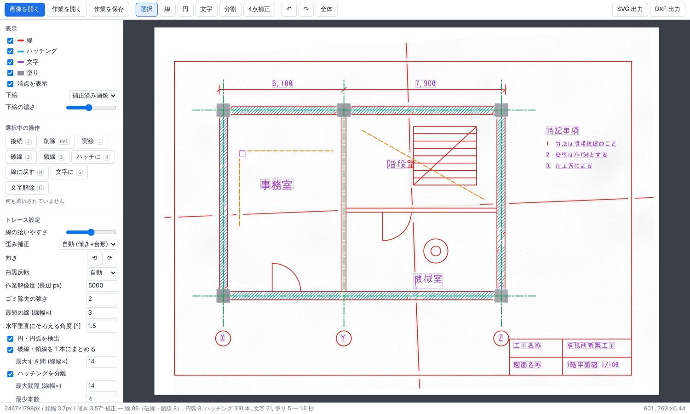

# trace-drawing

汚れた青焼き・手書き図面のスキャン画像を自動でトレースして **SVG / DXF** にするツールです。
Rust 製で、コマンドライン (ローカル PC) とブラウザ (WebAssembly) の両方で動きます。画像は外部に送信されません。



## 特徴

- **先に歪みと傾きを直す** — 図面の水平線・垂直線の消失点から、回転・せん断・台形歪みをまとめて自動補正。うまくいかない場合は図面枠の 4 隅をクリックして手動補正。
- **角を丸めない** — 出力は直線・円・円弧・折れ線だけ。曲線近似はせず、L 字の角は 2 直線の交点に置き直し、ほぼ水平・垂直の線は厳密な水平・垂直にそろえます。交差で線を分断しません。
- **ハッチングを無視できる** — 平行に並んだ線の束を検出して別レイヤに分け、既定では出力しません。誤判定は 1 キーで直せます。
- **破線・一点鎖線を 1 本の線として認識** — 切れ端の列を線種つきの 1 本の線にまとめます。認識漏れは範囲選択して `J` で接続。
- **文字は別レイヤへ** — 文字らしい小さなかたまりは線に混ぜずに分離 (OCR はしません)。必要な箇所だけ文字を打ち直せます。
- **青焼き向けの二値化** — シミ・焼けムラ・折り目の影を背景推定で打ち消し、かすれた線はヒステリシスでつなぎます。
- **手修正しやすい編集画面** — 下絵に重ねて表示、端点スナップ、範囲選択、Undo/Redo。

## 使い方

### ブラウザ版 (編集画面つき)

```sh
rustup target add wasm32-unknown-unknown
cargo install wasm-bindgen-cli --version 0.2.130   # Cargo.lock の wasm-bindgen と同じ版
./build-web.sh                                      # web/pkg を生成
cargo run --release -p trace-drawing -- serve       # http://127.0.0.1:8080/
```

`web/` は静的ファイルだけなので、任意の Web サーバに置いても動きます。
`samples/blueprint-sample.jpg` をドロップすると動作を試せます。

| 操作 | 方法 |
| --- | --- |
| 画面移動 / 拡大縮小 | 右 (中) ドラッグ・Space+ドラッグ / ホイール、`F` で全体表示 |
| 選択 | クリック (Shift で追加)。ハッチングは束ごと選択、Alt+クリックで 1 本ずつ |
| 範囲選択 | 右へドラッグ = 完全に含むもの、左へドラッグ = 触れたもの |
| 削除 | `Delete` |
| **接続** | `J` — 同一直線上の線 (破線の切れ端など) を 1 本に。交わる 2 本だけを選ぶと交点で角を作る |
| 線種 | `1` 実線 / `2` 破線 / `3` 一点鎖線 |
| ハッチング扱い / 線に戻す | `H` / `N` |
| 文字ブロックにまとめる / 解除 | `G` / `U`、文字ブロックをダブルクリックで文字入力 |
| 端点の移動 | 選択した線の端点をドラッグ (他の線の端点・交点にスナップ、Ctrl で無効、Shift で水平垂直) |
| 線 / 円 / 文字 / 分割 | `L` / `C` / `T` / `X` |
| 元に戻す / やり直す | `Ctrl+Z` / `Ctrl+Y` |

左のパネルで線の拾いやすさ・ハッチングの間隔・破線のすき間などを変えて再トレースできます。
出力欄に dpi と縮尺を入れると実寸 (mm) で書き出します。

### コマンドライン版 (一括変換)

```sh
cargo build --release -p trace-drawing
./target/release/trace-drawing 図面.png -o 図面.dxf -o 図面.svg --dpi 300 --scale 100
```

```
--params <file.json>   パラメータ JSON
--set <key=value>      個別に上書き (例: --set sensitivity=0.7 --set hatch_max_spacing=20)
--dpi <n> --scale <n>  スキャン解像度と縮尺の分母。指定すると実寸 (mm) で出力
--with-hatch           ハッチングも出力する
--no-text              文字レイヤを出力しない
--debug <dir>          補正後の画像と二値画像を PNG で保存 (調整の確認用)
--print-params         既定のパラメータを表示
```

`-o out.json` で書き出した結果は `python3 tools/preview.py out.json out.png` でレイヤ別に色分けして確認できます。

## 出力形式

- **DXF**: R12 (AC1009)・Shift_JIS。レイヤ `LINE` / `HATCH` / `TEXT` / `FILL`、線種 `CONTINUOUS` / `DASHED` / `CENTER`。Jw_cad・AutoCAD 系で読めます。
- **SVG**: レイヤごとの `<g>`、破線は `stroke-dasharray`。

## 仕組み

| 段階 | モジュール | 内容 |
| --- | --- | --- |
| 1 | `binarize` | ブロックごとに紙の明るさを推定して割り算 → 局所平均との差をノイズ量と比べて二値化 |
| 2 | `rectify` | 粗くトレースした線分から水平・垂直の消失点を求めて射影変換 |
| 3 | `morph` | ゴミ除去、線幅の推定、ベタ塗り領域の切り出し |
| 4 | `skeleton` | 細線化し、分岐点で区切ったチェーンに分解 |
| 5 | `fit` | チェーンを直線・円弧に当てはめ、角を交点に置き直す |
| 6 | `post` | 同一直線の統合、破線の一本化、ハッチング検出、文字の分離、端点の突き合わせ |
| 7 | `doc` / `export` | 編集操作 (選択・接続・Undo…) と SVG / DXF 出力 |

長さに関するパラメータは「代表線幅の何倍か」で指定するため、スキャン解像度が変わっても同じ設定が使えます。

## 制限

- 自動トレースは完全ではありません。手修正を前提にしています。
- 折り目やシワが濃く写っていると線として拾います (長い線なので選択して削除してください)。
- 文字の認識 (OCR) はしません。線に接した文字や大きな文字は線として残るので、範囲選択して `G` (文字に) か `Delete` で処理します。
- 曲線の破線、紙の伸び・波打ちのような局所的な歪みには対応していません。
- 合成画像でしか調整していないため、実際の図面では `sensitivity`・`hatch_max_spacing`・`text_max_size` などの調整が必要になることがあります。

## 開発

```sh
cargo test -p trace-core                 # 合成図面でのテスト
python3 tools/make_sample.py out.png     # 汚れた青焼き風のテスト画像を生成 (要 Pillow, numpy)
```
